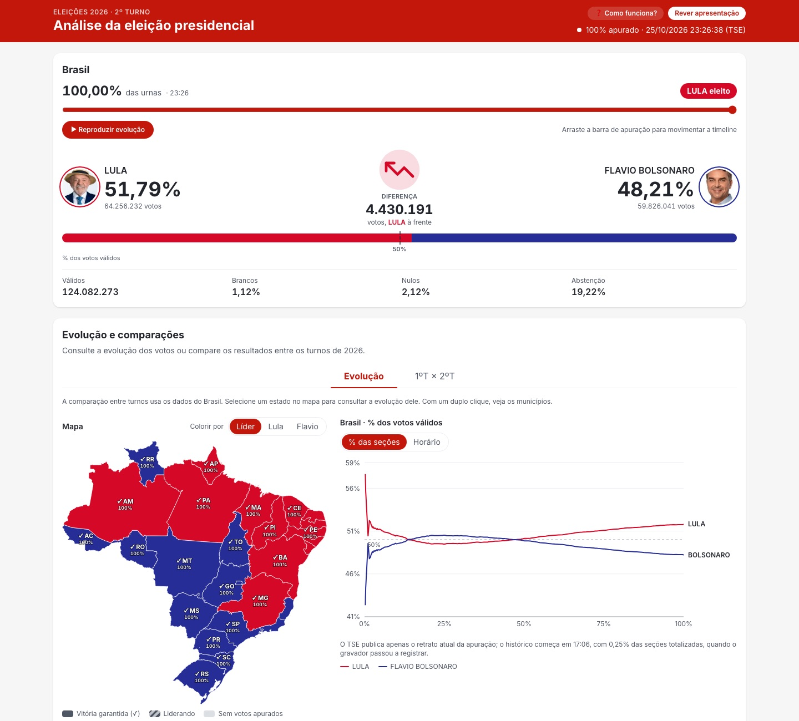

<div align="center">

# Apuração 2026 · Presidente

Resultado, replay e análise da eleição presidencial brasileira de 2026, com os dados oficiais do TSE preservados e publicados como site estático.

[](https://github.com/guichafy/brazil-president-elections/actions/workflows/deploy-pages.yml)
[](https://nodejs.org/)
[](https://nextjs.org/)
[](LICENSE)

**[Acessar o site →](https://guichafy.github.io/brazil-president-elections/)**

</div>

<p align="center">
  
</p>

## Sumário

- [Funcionalidades](#funcionalidades)
- [Tecnologias](#tecnologias)
- [Começando](#começando)
- [Scripts](#scripts)
- [Dados](#dados)
- [Deploy no GitHub Pages](#deploy-no-github-pages)
- [Estrutura do projeto](#estrutura-do-projeto)
- [Créditos e fontes](#créditos-e-fontes)
- [Licença](#licença)

## Funcionalidades

- **Apresentação em timelapse**: a apuração do 2º turno em 90 segundos, com música sincronizada, mapa em setores de pizza, fotos e votos por UF.
- **Placar**: votos e percentuais dos candidatos, diferença, válidos, brancos, nulos e abstenção.
- **Mapa do Brasil** por estado, colorido por líder ou por candidato, com seleção de UF e do exterior.
- **Municípios**: duplo clique no estado abre a tabela municipal, com ganhos em relação ao 1º turno, filtros por vencedor e viradas, totais e exportação em CSV.
- **Evolução da apuração**: linha do tempo nacional e de cada abrangência, por percentual apurado ou horário.
- **Replay**: a barra de percentual das urnas funciona como slider. Placar, mapa e gráfico acompanham o momento escolhido, com Play/Pausar e navegação por teclado.
- **Comparação entre turnos**: evolução do 2º turno sobreposta à do 1º, no mesmo ponto da apuração.
- **Tutorial** opcional pelo botão “Como funciona?”, que nunca abre sozinho.

> [!NOTE]
> Todos os resultados, fotos, sons, animações, malhas e fontes usados pelo site são locais. **O build e os acessos não consultam o TSE, o IBGE nem o Google.**

<details>
<summary>Tela inicial da apresentação</summary>


</details>

## Tecnologias

- [Next.js 16](https://nextjs.org/) com exportação estática (`output: "export"`), [React 19](https://react.dev/) e TypeScript
- [Tailwind CSS 4](https://tailwindcss.com/)
- [d3-geo](https://d3js.org/d3-geo) para os mapas, [Recharts](https://recharts.org/) para os gráficos e [lottie-web](https://airbnb.io/lottie/) para as animações
- Testes com o runner nativo do Node (`node --test`) e ESLint
- GitHub Actions + GitHub Pages para CI/CD

## Começando

### Pré-requisitos

- [Node.js](https://nodejs.org/) **24 ou superior**
- npm (incluído no Node)

### Instalação

```bash
git clone https://github.com/guichafy/brazil-president-elections.git
cd brazil-president-elections
npm ci
npm run dev
```

Abra <http://localhost:3000>. Os dados já estão versionados, então não é preciso internet nem executar o gravador.

### Gerar e visualizar o site estático

```bash
npm run build
npm run verify:export
npm run preview
```

O build gera `out/`, que pode ser servido por qualquer servidor estático. O preview serve exclusivamente esse conteúdo em <http://localhost:3000>; `next start` não é usado. `PORT=3001 npm run preview` altera a porta.

Para simular a URL de projeto do Pages (`/<repositorio>/`), use o mesmo prefixo no build e no preview:

```bash
NEXT_PUBLIC_BASE_PATH=/brazil-president-elections npm run build
NEXT_PUBLIC_BASE_PATH=/brazil-president-elections npm run verify:export
NEXT_PUBLIC_BASE_PATH=/brazil-president-elections npm run preview
```

### Variáveis de ambiente

| Variável | Padrão | Uso |
|---|---|---|
| `TSE_ELEICAO` | `6258` | Código da eleição: `6258` (2º turno) ou `6257` (1º turno). O site publicado usa o 2º turno. |
| `NEXT_PUBLIC_BASE_PATH` | vazio | Prefixo de URL. Vazio para domínio próprio ou `<usuario>.github.io`. |
| `PORT` | `3000` | Porta do `npm run preview`. |

## Scripts

| Comando | Descrição |
|---|---|
| `npm run dev` | Servidor de desenvolvimento |
| `npm run build` | Exporta o site estático para `out/` |
| `npm run verify:export` | Confere HTML, URLs, timelines, fotos e demais recursos do artefato |
| `npm run preview` | Serve `out/` localmente |
| `npm test` | Testes unitários (`tests/*.test.mjs`) |
| `npm run lint` | ESLint |
| `npm run archive` | Recaptura resultados e fotos do TSE ⚠️ requer internet |
| `npm run archive:municipios` | Recaptura resultados por município ⚠️ requer internet |
| `npm run archive:malhas` | Recaptura as malhas municipais do IBGE ⚠️ requer internet |
| `npm run recorder` | Gravador de snapshots usado durante a apuração ao vivo |

## Dados

| Arquivo | Conteúdo |
|---|---|
| `data/resultados-6257.json` / `resultados-6258.json` | Respostas brutas completas do TSE: Brasil, 27 UFs e exterior, com data de captura e fonte |
| `data/municipios-6257.json` / `municipios-6258.json` | Resultado compacto por município, conferido contra a soma de cada UF |
| `data/malhas/<uf>.json` | Malhas municipais do IBGE, simplificadas para o mapa |
| `data/snapshots-<eleicao>.jsonl` | Histórico gravado durante a apuração; não é substituído pela captura final |
| `data/eleitorado-<eleicao>.json` | Eleitorado por abrangência usado na projeção |
| `data/referencia-2022-2t.json` | Série histórica nacional do 2º turno de 2022 (preservada; não exibida na interface atual) |
| `data/audio-vitoria.json` / `audio-suspense.json` | Origem, recorte e SHA-256 dos áudios |
| `public/fotos/<eleicao>/<sqcand>.jpeg` | Fotos dos candidatos |

O TSE não disponibiliza a evolução da apuração de forma retrospectiva: os snapshots gravados são a única fonte do histórico e devem ser preservados.

### Atualizar os dados

> [!WARNING]
> Os comandos abaixo substituem os arquivos versionados. Eles nunca são chamados pelo build ou pelo deploy. Execute-os apenas quando quiser atualizar o arquivo e revise o diff antes de versionar.

Rode nesta ordem, pois cada etapa confere a anterior:

```bash
npm run archive                # resultados e fotos (ou: npm run archive -- 6258)
npm run archive:municipios     # depende de data/resultados-<eleicao>.json
npm run archive:malhas         # depende de data/municipios-<eleicao>.json
```

A captura exige finalização nacional, todas as seções contadas e totais consistentes. Depois de uma retotalização, `npm test` e `npm run verify:export` rejeitam divergências entre os snapshots e o resultado arquivado.

Mais detalhes:

- [docs/fontes-de-dados.md](docs/fontes-de-dados.md): endpoints do TSE, campos e fórmulas.
- [docs/funcionamento.md](docs/funcionamento.md): replay, timelapse, áudios e fidelidade ao indicador oficial `tf`.

## Deploy no GitHub Pages

O workflow [`deploy-pages.yml`](.github/workflows/deploy-pages.yml) instala as dependências pelo lockfile, executa lint e testes, exporta o site, verifica o artefato e publica no environment `github-pages`.

1. Em **Settings → Pages → Build and deployment → Source**, selecione **GitHub Actions**.
2. Faça push na `main` ou execute o workflow manualmente.

O prefixo de URL vem de `actions/configure-pages`, então funciona em `/<repositorio>/` e com domínio próprio. Pull requests executam validação e build, sem publicar. O deploy usa apenas o `GITHUB_TOKEN` e OIDC, sem secrets adicionais.

Versione `data/`, `public/`, `src/app/fonts/`, o código e o lockfile. **Não versione `out/`, `.next/` nem `node_modules/`**: o Actions gera `out/` e o envia como artefato do Pages.

## Estrutura do projeto

```text
.
├── data/                  # capturas do TSE, snapshots, municípios e malhas
├── docs/                  # documentação técnica e screenshots
├── public/                # fotos, sons e animações Lottie
├── scripts/               # captura de dados, gravador, preview e verificação
├── src/
│   ├── app/               # página, layout e rotas JSON exportadas em dados/
│   ├── components/        # mapa, placar, gráficos, timelapse, tutorial e áudio
│   └── lib/               # transformação dos dados do TSE, replay e utilitários
└── tests/                 # testes com node --test
```

| Caminho | Responsabilidade |
|---|---|
| `src/lib/static-data.ts` | Lê o arquivo local e calcula resultado, comparações e timelines no build |
| `src/lib/tse.ts` | Tipos e transformação das respostas brutas do TSE |
| `src/lib/replay.ts` | Restaura contagens históricas sem antecipar resultados nem modificar o arquivo final |
| `src/lib/assets.ts` | Aplica o prefixo de hospedagem aos assets locais |
| `src/app/page.tsx` | Gera o HTML inicial com resultado e timeline nacional |
| `src/app/dados/timeline/[arquivo]/route.ts` | Exporta a timeline de cada abrangência em JSON |
| `src/app/dados/municipios/[arquivo]/route.ts` | Exporta os municípios de cada UF em JSON |
| `src/app/dados/replay.json/route.ts` | Exporta os snapshots compactos e os índices de cada ciclo para o slider |
| `scripts/archive-*.mjs` | Captura explícita de resultados, fotos, municípios e malhas |
| `scripts/verify-export.mjs` | Validação do artefato exportado |

## Créditos e fontes

- **Resultados e fotos dos candidatos**: [Tribunal Superior Eleitoral (TSE)](https://resultados.tse.jus.br/).
- **Malhas municipais**: [API de malhas do IBGE](https://servicodados.ibge.gov.br/api/docs/malhas).
- **Fonte tipográfica**: [Inter](https://fonts.google.com/specimen/Inter), de Rasmus Andersson, sob a [SIL Open Font License 1.1](src/app/fonts/OFL.txt).
- **Áudios**: trechos de vídeos do YouTube, com a origem registrada em `data/audio-*.json`.

Este é um projeto independente, sem vínculo com o TSE, partidos ou candidatos.

## Licença

O código-fonte está sob a [licença MIT](LICENSE).

Materiais de terceiros incluídos no repositório **não** são cobertos por essa licença e pertencem aos seus titulares: dados e fotos do TSE, malhas do IBGE, áudios em `public/sons/` e `docs/prototypes/assets/`, animações em `public/lottie/`, a arte do TSE usada como ícone do site e a fonte Inter (SIL OFL 1.1).
